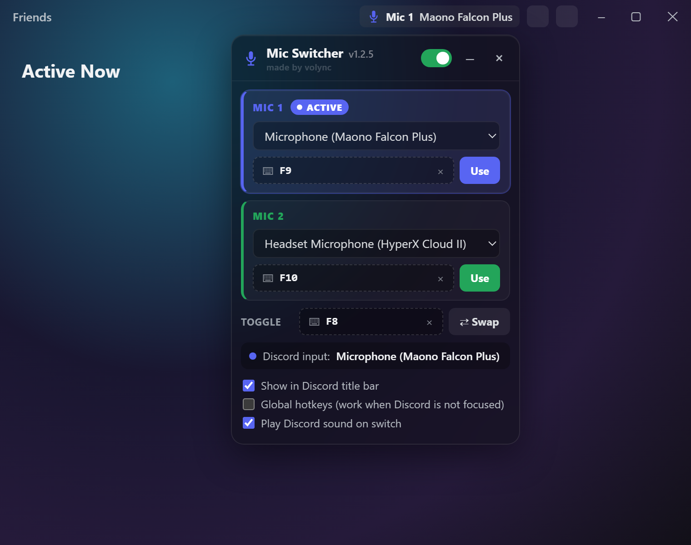

# Mic Switcher for Discord

Switch Discord's microphone between two input devices with a hotkey, without opening
Voice & Video settings. You stay connected to your call while it switches.



- **Two mic slots** with their own hotkeys (for example `F9` and `F10`), plus one toggle key
- **Lives in Discord's title bar** next to the inbox and help buttons. Click the chip to open
  the settings.
- **Switches Discord's real input device** using Discord's own internal function. The UI shows
  the device Discord actually uses.
- **Optional global hotkeys** that work while you're in a game, using Discord's native keybind
  system
- **Handles unplugged mics:** it warns you, and finds a mic again by name when it's plugged back in
- **Auto-start** that survives Discord updates, or a one-time console paste
- Works alongside Vencord

> ⚠️ Windows, Discord desktop app. Unofficial and not affiliated with Discord. Running custom code
> in the client is against Discord's Terms of Service; see [Limitations](#limitations).
>
> 📄 **Source-available, personal use only.** You may not redistribute, resell or rebrand it;
> see [License](#license).

## Download

Click **Code → Download ZIP** on this page (or `git clone` the repository). Extract it to a folder
you will keep, such as `C:\Tools\discord-mic-switcher`. The auto-start loads the script from
that folder every time Discord starts.

---

## Auto-start with Discord (recommended)

A small hook goes into Discord's startup file:
`%LOCALAPPDATA%\Discord\app-1.0.XXXX\modules\discord_desktop_core-1\discord_desktop_core\index.js`

On every Discord start or reload, the hook reads `mic-switcher.js` from this folder and runs
it in the Discord window. It does the same thing as pasting the script into the console. It
works alongside Vencord, because Vencord patches `resources\app.asar` and not this file.

### Option A: run the installer
1. Double-click **`install-autostart.cmd`** in this folder. It does two things:
   - **Hook:** it prints `Installed: ...\discord_desktop_core\index.js` and saves a backup next
     to the file (`index.js.micswitcher-backup`).
   - **Update guard:** it prints `Update guard: running, starts with Windows...`. See
     "Discord updates" below.
2. **Fully quit Discord:** right-click the tray icon → **Quit Discord**. Closing the window
   is not enough.
3. Start Discord. The 🎙 Mic chip appears in the title bar a few seconds after Discord loads.

To remove everything (hook and guard), double-click **`uninstall-autostart.cmd`**, then restart
Discord.

#### Discord updates
Every Discord update installs a fresh startup file, which removes the hook:
- a host update creates a new `app-1.0.XXXX` folder
- a module update creates a new `discord_desktop_core-2` folder

Updates usually run on the "Checking for updates" splash screen, so nothing inside Discord can
put the hook back in time. The **update guard** does it from outside:
- It's a hidden background process that starts with Windows. It's registered under
  `HKCU\...\Run` as `MicSwitcherAutostartGuard`.
- It watches `%LOCALAPPDATA%\Discord`. When an update writes a new startup file, it adds the hook
  back **within about half a second**, before Discord loads that file. It also re-checks every
  60 seconds.
- It uses no CPU while idle and about 12 MB of RAM. It writes a log to
  `%LOCALAPPDATA%\MicSwitcher\autostart-guard.log` each time it re-applies the hook.

Don't want a background process? Run `install-autostart.ps1 -NoGuard` instead. You will then
need to re-run the installer after every Discord update.

### Option B: do it by hand
1. Fully quit Discord (tray icon → **Quit Discord**).
2. Open `%LOCALAPPDATA%\Discord\`. Go into the **newest** `app-1.0.XXXX` folder, then
   `modules\discord_desktop_core-1\discord_desktop_core\`.
3. Make a copy of `index.js` as a backup. Then open `index.js` in a text editor. It contains one line:
   ```js
   module.exports = require('./core.asar');
   ```
4. Paste this block **above** that line. Change the path in `SCRIPT` to where your
   `mic-switcher.js` is, using forward slashes `/`:
   ```js
   // [MicSwitcher autostart]
   try {
     const { app } = require('electron');
     const fs = require('fs');
     const SCRIPT = 'C:/Tools/discord-mic-switcher/mic-switcher.js';
     const isMainPage = (url) => /^https:\/\/(canary\.|ptb\.)?discord\.com\//.test(url) && !/popout|overlay/i.test(url);
     app.on('browser-window-created', (_e, win) => {
       const wc = win.webContents;
       wc.on('dom-ready', () => {
         if (!isMainPage(wc.getURL())) return;
         let code;
         try { code = fs.readFileSync(SCRIPT, 'utf8'); } catch (e) { console.error('[MicSwitcher] cannot read ' + SCRIPT, e); return; }
         wc.executeJavaScript('window.__MIC_SWITCHER_AUTOLOAD__ = true;\n' + code + '\n//# sourceURL=mic-switcher.js')
           .catch((e) => console.error('[MicSwitcher] inject failed', e));
       });
     });
   } catch (e) { console.error('[MicSwitcher] autostart hook failed', e); }
   // [/MicSwitcher autostart]
   ```
5. Save the file and start Discord.

To remove it by hand, delete the block (or restore your backup copy).

### Good to know
- **Updates:** with Option A, the update guard handles Discord updates automatically. If you used
  Option B or `-NoGuard`, repeat the setup after a Discord update.
- **Keep the folder where it is.** The hook and the guard load files from this folder. If you
  move it, run `install-autostart.cmd` again from the new location. Edits to `mic-switcher.js`
  take effect the next time Discord starts or reloads (Ctrl+R).
- If the panel doesn't appear, press Ctrl+Shift+I and look in the Console for
  `[MicSwitcher]` messages.

---

## One-time use: paste in the console

1. Open Discord and press **Ctrl+Shift+I**. Go to the **Console** tab.
   If nothing opens, DevTools is turned off in your client. Add
   `"DANGEROUS_ENABLE_DEVTOOLS_ONLY_ENABLE_IF_YOU_KNOW_WHAT_YOURE_DOING": true` to
   `%APPDATA%\discord\settings.json`, then restart Discord. The auto-start above does not need
   DevTools.
2. Open `mic-switcher.js`, select everything (**Ctrl+A**) and copy it.
3. Paste it into the console and press **Enter**.
   If DevTools shows a paste warning, type `allow pasting`, press Enter, then paste again.
4. The 🎙 Mic chip appears in Discord's title bar. The console prints
   `[MicSwitcher] v1.2.5 loaded…`.

Pasting the script a second time is safe. The old copy is removed before the new one starts.

### Faster re-runs: save the script as a DevTools snippet
DevTools → **Sources** → **Snippets** → **+ New snippet** → paste the script → save it as `mic`.
After that, in DevTools press **Ctrl+P**, type `!mic` and press **Enter**.

---

## Usage

| Control | What it does |
|---|---|
| **MIC 1 / MIC 2 dropdown** | Pick a device for each slot. The list comes from Discord's own device list, so it shows exactly the devices Voice & Video settings shows. |
| **⌨ hotkey button** | Click it, then press a key combo (for example `F9` or `Ctrl+Shift+1`). **Esc** cancels. **Backspace** clears. **×** removes the bind. |
| **Use** | Switch to that mic now. |
| **TOGGLE** key / **⇄ Swap** | One key that alternates between Mic 1 and Mic 2. |
| **ACTIVE** badge + "Discord input" | Shows the device Discord is **really** using. The script reads it back from Discord after every switch and whenever settings change. |
| **On/off switch** (header) | Turns all hotkeys off and on. The **Use** buttons keep working. |
| **Title-bar chip** (default) | A small "🎙 Mic 1 · device" button in Discord's top bar, just left of the inbox and help icons. The icon colour shows the active slot. Click it to open the panel under it; click anywhere else to close it. |
| **Show in Discord title bar** | Untick it to get the floating panel back. That mode is also used automatically if the title bar can't be found (for example, Discord in a browser). |
| **–** | Closes the panel. In floating mode it shrinks to a small pill that you can drag; click the pill to open the panel again. |
| **×** | Removes the plugin until you paste it again. |
| **Global hotkeys** | Hotkeys also work while Discord is **not focused** (in a game, for example). See the notes below. |
| **Play Discord sound** | Plays Discord's normal "device changed" sound on each switch. Untick it for silent switching. |

All settings (devices, hotkeys, options, panel position) are saved in Discord's localStorage
and come back when you paste the script again after a reload or restart.

### Console commands
```js
MicSwitcher.toggle()      // switch to the other mic
MicSwitcher.switchTo(0)   // 0 = Mic 1, 1 = Mic 2
MicSwitcher.show()        // reopen the panel
MicSwitcher.diagnose()    // print what was found, the device table and the current state
MicSwitcher.destroy()     // remove everything
```

---

## How it works

This was checked against Discord's code in build `web.f25377cf5b911919` (November 2026):

- Discord keeps input devices in its internal **`MediaEngineStore`** (`getInputDevices()`,
  `getInputDeviceId()`). This is the same list the settings page shows.
- When you choose a mic in Voice & Video settings, Discord calls
  **`AudioActionCreators.setInputDevice(id)`**. That function sends the flux action
  **`AUDIO_SET_INPUT_DEVICE`**. `MediaEngineStore` then saves the setting, tells the native voice
  engine to use the device, and updates **every active voice connection** in place. You stay
  connected to the call.
- The script calls that same function. In silent mode, or if Discord ignores the call, it sends
  `AUDIO_SET_INPUT_DEVICE` itself. It then reads the device back from Discord. If Discord did not
  switch, you get a red error message, not a false "switched".
- The script finds these modules by their **method names**, not by the short minified export
  names (`Z`, `ZP`, `A`, `Ay`…). Those names change between Discord builds, so this lookup keeps
  working after small updates.
- Discord loads three separate webpack runtimes (`fast-connect`, `sentry` and the main `web` one)
  that share `webpackChunkdiscord_app`. The script searches all of them. If a module isn't in the
  cache, it falls back to finding the module by its source code.
- **In-app hotkeys** listen for key presses at the window level and handle them before Discord
  does. They work anywhere in Discord, with the panel open or shrunk.
- **Global hotkeys** use Discord's native keybind API (`discord_utils.inputEventRegister`), the same
  one push-to-talk uses. The script registers its binds under its own IDs, far above Discord's,
  and removes them when you disable the option or remove the plugin.

### Handling problems
- **Mic unplugged:** the slot shows **DISCONNECTED** and its **Use** button is disabled. A hotkey
  for that slot shows a message and leaves your current mic unchanged.
- **Mic plugged back in with a new ID:** the script finds it again by name and updates the slot.
- **Bind conflicts:** you cannot give the same combo to two actions. `Esc`, `Tab`, `Enter` and
  Ctrl+C/V/X/A/Z/Y are blocked. The script warns you when a combo replaces a Discord shortcut
  (for example `Ctrl+K`).
- **Plain letter or number keys** (no Ctrl/Alt) are ignored while you type in a text box, so they
  don't break chat.

---

## Limitations

- **A console paste only lasts until Discord restarts or reloads (Ctrl+R).** Use the
  auto-start setup above to load it every time. Your settings are kept either way.
- **Global hotkeys:**
  - They need the Discord **desktop app**. The browser version only gets in-app hotkeys.
  - A modifier binds to the side you pressed. A bind recorded with **Right Ctrl** fires with Right
    Ctrl only.
  - Discord's native layer allows at most 8 single-letter global binds and rejects plain letters
    after that. Use F-keys or combos.
  - If a combo is also a Discord keybind (for example push-to-talk), both will fire.
- **This depends on Discord internals.** A future Discord update could rename these functions. In
  that case the script stops with a clear console error and installs nothing.
  `MicSwitcher.diagnose()` shows which part is missing.
- Running custom code in the client is technically outside Discord's Terms of Service. The script
  only calls functions Discord already uses itself and sends nothing over the network. The risk is
  low, but it is not zero.

## Troubleshooting

| Symptom | Fix |
|---|---|
| `webpackChunkdiscord_app not found` | Make sure the Console context dropdown says **top**, then paste again. |
| `MediaEngineStore not found` | Discord changed its internals. Open an issue and include the console error and the output of `MicSwitcher.diagnose()`. |
| Red "Discord did not accept Mic N" | Discord refused the device. Check that the same mic works when you choose it in Voice & Video settings. |
| Can't find the panel | Run `MicSwitcher.show()`. The panel's position is always kept inside the window. |
| Windows warns when you run `install-autostart.cmd` | Files downloaded from the internet are marked as blocked. Right-click the file → **Properties** → tick **Unblock** → OK, then run it again. |

## License

**Source-available, not open source.**
Copyright © 2026 volync. All rights reserved.

The code is public so that you can read exactly what it does before you run it inside your
Discord client. Being public on GitHub does **not** make it free to reuse. Under the
[LICENSE](LICENSE):

| ✅ You may | ❌ You may not, without written permission |
|---|---|
| Download it from this repository and use it yourself, free and non-commercially | Re-upload, mirror or share copies of the files (share the link instead) |
| Change your own copy for your own use | Publish modified versions or rebrands |
| Share links, screenshots and videos, with credit | Sell it, bundle it, or use it commercially |
| Contribute through pull requests (see [CONTRIBUTING.md](CONTRIBUTING.md)) | Remove the copyright notices or the "made by volync" credit, or claim it as your own |

Want to use it in another project, or commercially? Ask through [GitHub Issues](https://github.com/volync/discord-mic-switcher/issues).

Mic Switcher is an unofficial project. It is not affiliated with, endorsed by or sponsored by
Discord Inc. "Discord" is a trademark of Discord Inc. The license covers this code only. It
does **not** make running client modifications compliant with Discord's Terms of Service; see
[Limitations](#limitations).
